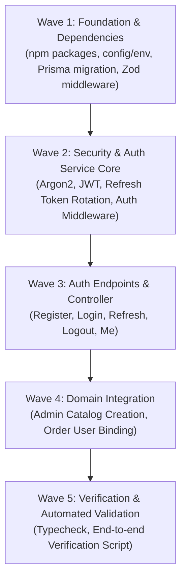

# Phase 1 Execution Plan: Core Backend & Authentication

**Phase:** Phase 1: Core Backend, Authentication & Order Context  
**Context File:** [`01-CONTEXT.md`](file:///home/aravind/Nodejs_Projects_Adv/order-inventory-api/.planning/01-CONTEXT.md)  
**Status:** Approved for Execution  
**Target Completion:** Foundation for Phase 2 Concurrency & Idempotency  

---

## 1. Executive Summary & Goal

Phase 1 establishes production-grade security, authentication, and domain identity for the Order & Inventory Management API. It eliminates all hardcoded test shims (specifically `TEMPORARY_TEST_USER_ID = "test-user-001"` in `src/controllers/order.controller.ts`), provides robust user lifecycle management (registration, login, refresh token rotation, role guards), introduces type-safe input validation using **Zod**, and restricts catalog mutations to authenticated administrators.

---

## 2. Technical Contracts & Locked Decisions

- **Validation:** **Zod** (`zod`) for all request schemas (`body`, `query`, `params`).
- **Password Hashing:** **Argon2** (`argon2`) with memory-hard hashing standards.
- **Authentication:** Dual-token strategy:
  - **Access Token:** Stateless JWT (`jsonwebtoken`), 15-minute expiration, passed in `Authorization: Bearer <token>`.
  - **Refresh Token:** Cryptographically secure 256-bit random hex string, stored hashed (SHA-256) in PostgreSQL `RefreshToken` table with 7-day expiration and automatic reuse detection.
- **Role Guard:** `UserRole` enum (`CUSTOMER`, `ADMIN`). Admin registration requires `ADMIN_REGISTRATION_SECRET`.
- **Order Attribution:** Orders created strictly under the authenticated user's ID (`req.user.id`).

---

## 3. Dependency Waves & Actionable Tasks



---

### Wave 1: Foundation, Config & Database Migration

#### Task 1.1: Install Dependencies
- **Action:** Install runtime dependencies `argon2`, `jsonwebtoken`, `zod` and dev dependencies `@types/jsonwebtoken`.
- **Command:** `npm install argon2 jsonwebtoken zod && npm install -D @types/jsonwebtoken`

#### Task 1.2: Environment Configuration
- **Files:** `src/config/env.ts`, `.env.example`, `.env`
- **Additions:**
  - `JWT_SECRET`: Non-empty string (minimum 32 characters in production).
  - `JWT_EXPIRES_IN`: String (default `"15m"`).
  - `REFRESH_TOKEN_EXPIRES_DAYS`: Number (default `7`).
  - `ADMIN_REGISTRATION_SECRET`: String (default for development: `"dev-admin-secret-change-in-prod"`).
- **Validation:** Extend `loadConfig()` with strict validations and helpful errors.

#### Task 1.3: Prisma Schema & Migration for Refresh Tokens
- **File:** `prisma/schema.prisma`
- **Model Addition:**
  ```prisma
  model RefreshToken {
    id              String    @id @default(cuid())
    userId          String    @map("user_id")
    tokenHash       String    @map("token_hash") @db.VarChar(64)
    expiresAt       DateTime  @map("expires_at") @db.Timestamptz(3)
    revokedAt       DateTime? @map("revoked_at") @db.Timestamptz(3)
    replacedByToken String?   @map("replaced_by_token") @db.VarChar(64)
    createdAt       DateTime  @default(now()) @map("created_at") @db.Timestamptz(3)

    user User @relation(fields: [userId], references: [id], onDelete: Cascade)

    @@index([userId])
    @@index([tokenHash])
    @@map("refresh_tokens")
  }
  ```
- **Relation:** Add `refreshTokens RefreshToken[]` to `User` model.
- **Execution:** Run `npm run db:generate` and database migration.

#### Task 1.4: Reusable Zod Validation Middleware
- **File:** `src/middleware/validate.ts`
- **Signature:** `validate(schema: { body?: ZodSchema, query?: ZodSchema, params?: ZodSchema })`
- **Error Format:** Returns `400 Bad Request` with code `VALIDATION_ERROR` and structured details matching `docs/api-contract.md`.

---

### Wave 2: Security & Auth Service Core

#### Task 2.1: Zod Schemas for Authentication
- **File:** `src/validation/auth.schema.ts`
- **Schemas:**
  - `registerSchema`: `email` (valid email), `password` (string, min 8 chars), `role` (optional enum `CUSTOMER` | `ADMIN`), `adminSecret` (optional string).
  - `loginSchema`: `email`, `password`.
  - `refreshTokenSchema`: `refreshToken` (non-empty string).

#### Task 2.2: Auth Service Implementation
- **File:** `src/services/auth.service.ts`
- **Methods:**
  - `register(input)`:
    - Verifies email uniqueness (`409 CONFLICT` if taken).
    - If `role === 'ADMIN'`, verifies `adminSecret === config.adminRegistrationSecret` (`403 FORBIDDEN` if mismatch).
    - Hashes password using `argon2.hash()`.
    - Creates user record.
    - Generates JWT access token and cryptographic random refresh token.
    - Stores SHA-256 hash of refresh token in `RefreshToken` table.
    - Returns sanitized user profile, `accessToken`, and `refreshToken`.
  - `login(input)`:
    - Finds user by email (`401 UNAUTHORIZED` if not found).
    - Verifies password using `argon2.verify()` (`401 UNAUTHORIZED` if mismatch).
    - Generates and stores new token pair.
  - `refresh(refreshTokenString)`:
    - Computes SHA-256 hash of provided token.
    - Queries `RefreshToken` by `tokenHash`.
    - If not found or expired (`expiresAt < now()`): throws `401 UNAUTHORIZED`.
    - **Reuse Detection:** If `revokedAt !== null`, revokes ALL refresh tokens for `userId` (compromise detection) and throws `401 UNAUTHORIZED`.
    - If valid: revokes current token (`revokedAt = now()`), issues new access token + new rotated refresh token, links `replacedByToken`, and commits in transaction.
  - `logout(refreshTokenString)`:
    - Hashes token and sets `revokedAt = now()`.

#### Task 2.3: Authentication & Role Middleware
- **Files:** `src/middleware/auth.ts`, `src/types/express.d.ts`
- **Components:**
  - `authenticate`: Extracts `Authorization: Bearer <token>`, verifies JWT signature, attaches `req.user = { id, email, role }`. Returns `401 UNAUTHORIZED` if missing/invalid/expired.
  - `requireRole(allowedRoles: UserRole[])`: Checks `req.user.role`. Returns `403 FORBIDDEN` if unauthorized.
  - Express type augmentation declaring `Express.Request.user`.

---

### Wave 3: Auth Controller, Routes & App Wiring

#### Task 3.1: Auth Controller
- **File:** `src/controllers/auth.controller.ts`
- **Handlers:**
  - `register(req, res)` -> `201 Created`
  - `login(req, res)` -> `200 OK`
  - `refreshToken(req, res)` -> `200 OK`
  - `logout(req, res)` -> `200 OK`
  - `getMe(req, res)` -> `200 OK`

#### Task 3.2: Auth Routes
- **File:** `src/routes/auth.routes.ts`
- **Endpoints:**
  - `POST /register` -> `validate(registerSchema)` -> `register`
  - `POST /login` -> `validate(loginSchema)` -> `login`
  - `POST /refresh` -> `validate(refreshTokenSchema)` -> `refreshToken`
  - `POST /logout` -> `validate(refreshTokenSchema)` -> `logout`
  - `GET /me` -> `authenticate` -> `getMe`

#### Task 3.3: Mount Auth Router in App
- **File:** `src/app.ts`
- **Integration:** Mount `authRouter` at `/api/v1/auth`.

---

### Wave 4: Domain Integration (Catalog Management & Order User Binding)

#### Task 4.1: Product Validation Schemas & Admin Creation
- **Files:** `src/validation/product.schema.ts`, `src/services/product.service.ts`, `src/controllers/product.controller.ts`, `src/routes/product.routes.ts`
- **Features:**
  - `createProductSchema`: `name` (min 1, max 200), `sku` (min 1, max 64), `description` (optional), `priceInPaise` (positive integer), `initialStock` (non-negative integer).
  - `productService.createProduct(...)`: Transactionally creates `Product` and initial `Inventory` entry.
  - Mount `POST /api/v1/products` guarded by `authenticate` and `requireRole([UserRole.ADMIN])`.

#### Task 4.2: Clean Up Order Controller & Enforce Authentication
- **Files:** `src/controllers/order.controller.ts`, `src/routes/order.routes.ts`, `src/validation/order.schema.ts`
- **Actions:**
  - Delete `const TEMPORARY_TEST_USER_ID = "test-user-001"`.
  - Add `validate(createOrderSchema)` to `POST /api/v1/orders`.
  - Guard `POST /api/v1/orders` with `authenticate`.
  - Pass `req.user!.id` directly to `orderService.createOrder({ userId: req.user!.id, items })`.

---

### Wave 5: Verification & Automated Testing

#### Task 5.1: Phase 1 End-to-End Verification Script
- **File:** `scripts/test-phase1-auth.ts`
- **Automated Checks:**
  1. Register a new Customer (`201 Created`).
  2. Attempt duplicate registration with same email (`409 Conflict`).
  3. Attempt Admin registration with wrong/missing secret (`403 Forbidden`).
  4. Register Admin with correct secret (`201 Created`).
  5. Login as Customer with incorrect password (`401 Unauthorized`).
  6. Login as Customer with valid password (`200 OK`, returns access & refresh tokens).
  7. Access `GET /api/v1/auth/me` with Bearer token (`200 OK`).
  8. Rotate refresh token via `POST /api/v1/auth/refresh` (`200 OK`, old token revoked, new tokens issued).
  9. Re-use revoked refresh token -> Assert all user tokens invalidated (`401 Unauthorized`).
  10. Attempt `POST /api/v1/products` as Customer -> Assert `403 Forbidden`.
  11. Attempt `POST /api/v1/products` as Admin -> Assert `201 Created`.
  12. Create order via `POST /api/v1/orders` as authenticated Customer -> Assert order created with customer's `userId`.

#### Task 5.2: Typecheck & Build Validation
- **Action:** Run `npm run typecheck` to verify zero TypeScript errors.

---

## 4. Acceptance Criteria & Definition of Done

- [ ] `npm run typecheck` completes with zero errors.
- [ ] Database contains `refresh_tokens` table with proper foreign key and indexes.
- [ ] All auth endpoints (`/register`, `/login`, `/refresh`, `/logout`, `/me`) functional and conforming to `docs/api-contract.md`.
- [ ] Zod schema validation returns consistent `400 Bad Request` with field details on invalid payloads.
- [ ] `TEMPORARY_TEST_USER_ID` completely eradicated from codebase; orders require authenticated user.
- [ ] `POST /api/v1/products` restricted to `ADMIN` role.
- [ ] `tsx scripts/test-phase1-auth.ts` completes 100% of test scenarios with green output.
