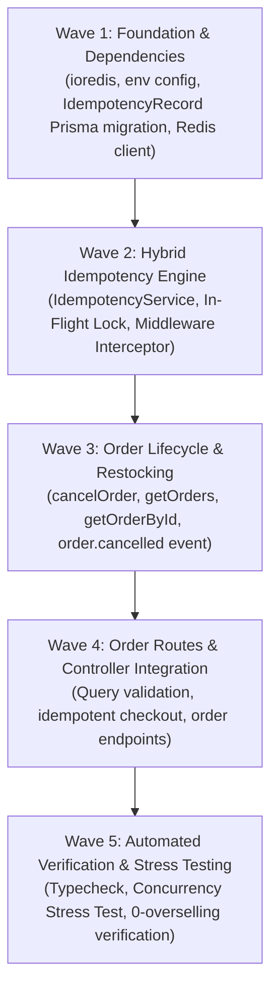

# Phase 2 Execution Plan: Concurrency, Inventory & Hybrid Idempotency

**Phase:** Phase 2: Concurrency, Inventory Management & Hybrid Idempotency  
**Context File:** [`02-CONTEXT.md`](file:///home/aravind/Nodejs_Projects_Adv/order-inventory-api/.planning/02-CONTEXT.md)  
**Status:** Approved for Execution  
**Target Completion:** Foundation for Phase 3 Caching & Rate Limiting  

---

## 1. Executive Summary & Goal

Phase 2 hardens the Order & Inventory Management API against real-world distributed system failure modes: duplicate request retries, race conditions under high concurrency, inventory overselling, and unhandled order cancellations. 

By the end of Phase 2, the system will support:
1. **Hybrid Idempotency Framework:** Combining Redis in-flight distributed mutex locks with PostgreSQL `IdempotencyRecord` table for ACID durability.
2. **Zero-Overselling Concurrency Guarantees:** Deterministic lock sorting and atomic conditional stock decrements under serializable isolation.
3. **Complete Order Lifecycle:** Scoped order querying with pagination, order detail inspection, and order cancellation with atomic inventory restocking and domain event emission.

---

## 2. Technical Contracts & Locked Decisions

- **Idempotency Header:** `Idempotency-Key` (required on checkout `POST /api/v1/orders`).
- **In-Flight Lock (Redis):** `SET idempotency:lock:<userId>:<key> "LOCKED" NX EX 30`. Returns `409 Conflict` (`IDEMPOTENCY_KEY_IN_FLIGHT`) if another request with the same key is active.
- **Durable Store (PostgreSQL):** Stores `statusCode`, `requestHash`, and `responseBody` in `IdempotencyRecord`. Returns identical cached response on duplicate requests. Returns `422 Unprocessable Entity` (`IDEMPOTENCY_PAYLOAD_MISMATCH`) if payload hash has changed.
- **Order Cancellation:** `POST /api/v1/orders/:id/cancel` allowed only for `PENDING` orders. Atomically increments stock for all items within a transaction and transitions status to `CANCELLED`.
- **Tenant Isolation:** Regular customers can only query and cancel their own orders. Admins can view/cancel any order.

---

## 3. Dependency Waves & Actionable Tasks



---

### Wave 1: Foundation, Config & Database Migration

#### Task 1.1: Install Dependencies
- **Action:** Install `ioredis` and `@types/ioredis`.
- **Command:** `npm install ioredis && npm install -D @types/ioredis`

#### Task 1.2: Environment Configuration
- **Files:** `src/config/env.ts`, `.env.example`, `.env`
- **Additions:**
  - `REDIS_URL`: String (default `"redis://localhost:6379"`).
  - `IDEMPOTENCY_LOCK_TTL_SECONDS`: Number (default `30`).
- **Validation:** Extend `loadConfig()` with safe defaults and validation.

#### Task 1.3: Prisma Schema & Migration for Idempotency
- **File:** `prisma/schema.prisma`
- **Model Addition:**
  ```prisma
  model IdempotencyRecord {
    key          String   @id @db.VarChar(128)
    userId       String   @map("user_id")
    endpoint     String   @db.VarChar(255)
    requestHash  String   @map("request_hash") @db.VarChar(64)
    statusCode   Int      @map("status_code")
    responseBody Json     @map("response_body")
    createdAt    DateTime @default(now()) @map("created_at") @db.Timestamptz(3)

    user User @relation(fields: [userId], references: [id], onDelete: Cascade)

    @@index([userId, createdAt])
    @@map("idempotency_records")
  }
  ```
- **Relation:** Add `idempotencyRecords IdempotencyRecord[]` to `User` model.
- **Execution:** Create migration file, run `npm run db:generate`.

#### Task 1.4: Resilient Redis Client Module
- **File:** `src/db/redis.ts`
- **Features:**
  - Instantiates `Redis` client with `lazyConnect: true`, max retry attempts, and exponential backoff.
  - In-memory fallback adapter: If Redis server is not running locally, seamlessly falls back to a memory-backed lock store so development and testing continue without blocking.

---

### Wave 2: Hybrid Idempotency Engine

#### Task 2.1: Idempotency Validation & Hashing
- **Files:** `src/validation/idempotency.schema.ts`, `src/utils/hash.ts`
- **Specifications:**
  - Validates `Idempotency-Key` header (non-empty string, min 8, max 128 chars).
  - SHA-256 hash generator for deterministic request payload comparison (`requestHash`).

#### Task 2.2: Idempotency Service Implementation
- **File:** `src/services/idempotency.service.ts`
- **Methods:**
  - `acquireLock(userId, key)`: Acquires Redis mutex with 30s TTL. Throws `409 Conflict` if already held.
  - `releaseLock(userId, key)`: Releases the Redis mutex lock.
  - `getExistingRecord(key, userId, requestHash)`: Checks PostgreSQL for completed records. Returns cached response or throws `422` on hash mismatch.
  - `saveRecord(key, userId, endpoint, requestHash, statusCode, responseBody)`: Saves completed response to PostgreSQL.

#### Task 2.3: Idempotency Middleware Interceptor
- **File:** `src/middleware/idempotency.ts`
- **Flow:**
  1. Validates presence of `Idempotency-Key` header.
  2. Computes `requestHash`.
  3. Checks PostgreSQL for existing completed record. If found, immediately returns cached status code and response payload.
  4. Acquires Redis in-flight lock.
  5. Intercepts `res.json` / `res.send` to capture the final output.
  6. On successful response (`2xx`), records outcome in PostgreSQL `IdempotencyRecord`.
  7. In `res.on('finish')` or `res.on('close')`, releases Redis in-flight lock.

---

### Wave 3: Order Lifecycle & Atomic Restocking

#### Task 3.1: Order Cancellation with Atomic Restock
- **File:** `src/services/order.service.ts`
- **Method:** `cancelOrder(orderId: string, userId: string, userRole: UserRole)`
- **Behavior:**
  - Retrieves order with items.
  - Verifies ownership (throws `404 Not Found` if order doesn't exist or belongs to another user without admin role).
  - Enforces state machine: order must be in `PENDING` status. Throws `400 Bad Request` if already `CANCELLED`, `PAID`, or `FAILED`.
  - Transactionally:
    1. Sets order status to `CANCELLED`.
    2. Atomically increments inventory (`tx.inventory.update({ where: { productId }, data: { quantity: { increment: item.quantity } } })`) for every line item.
  - Emits `order.cancelled` on `orderEventBus`.

#### Task 3.2: Scoped Order Querying & Pagination
- **File:** `src/services/order.service.ts`
- **Methods:**
  - `getOrders({ userId, userRole, page, limit, status, targetUserId? })`:
    - Normalizes `page` (default 1) and `limit` (default 10, max 50).
    - If customer: forces `where.userId = userId`. If admin: permits filtering by `targetUserId`.
    - Returns `{ items, pagination: { page, limit, totalItems, totalPages } }`.
  - `getOrderById(orderId: string, userId: string, userRole: UserRole)`:
    - Finds order by ID with line items and product details.
    - Tenant guard: if not admin and `order.userId !== userId`, throws `404 Not Found`.

#### Task 3.3: Domain Event Handlers
- **File:** `src/events/order-event-handlers.ts`
- **Features:** Adds listener for `order.cancelled` logging audit metrics and prepared for Phase 4 queue forwarding.

---

### Wave 4: Order Routes & Controller Integration

#### Task 4.1: Order Query Validation
- **File:** `src/validation/order.schema.ts`
- **Additions:**
  - `orderQuerySchema`: `page` (int, min 1), `limit` (int, min 1, max 50), `status` (optional `OrderStatus`), `userId` (optional string for admin).
  - `orderIdParamSchema`: `id` (non-empty string).

#### Task 4.2: Order Controller Endpoints
- **File:** `src/controllers/order.controller.ts`
- **Handlers:**
  - `createOrder`: Updated to pass idempotency context.
  - `cancelOrder`: Invokes `orderService.cancelOrder`.
  - `getOrders`: Invokes `orderService.getOrders` with pagination.
  - `getOrderById`: Invokes `orderService.getOrderById`.

#### Task 4.3: Order Routes Wiring
- **File:** `src/routes/order.routes.ts`
- **Wiring:**
  - `POST /`: `authenticate`, `idempotencyMiddleware`, `validate({ body: createOrderSchema })`, `createOrder`
  - `GET /`: `authenticate`, `validate({ query: orderQuerySchema })`, `getOrders`
  - `GET /:id`: `authenticate`, `validate({ params: orderIdParamSchema })`, `getOrderById`
  - `POST /:id/cancel`: `authenticate`, `validate({ params: orderIdParamSchema })`, `cancelOrder`

---

### Wave 5: Automated Verification & Concurrency Stress Testing

#### Task 5.1: Concurrency & Idempotency Test Suite
- **File:** `scripts/test-phase2-concurrency.ts`
- **Automated Verification Scenarios:**
  1. **Idempotency Replay:** Repeating identical checkout request with same `Idempotency-Key` returns original order and does not decrement stock twice.
  2. **Tampering Detection:** Replaying `Idempotency-Key` with altered payload returns `422 Unprocessable Entity`.
  3. **In-Flight Lock Protection:** Two concurrent requests fired with the same key simultaneously result in 1 proceeding and 1 receiving `409 Conflict`.
  4. **Concurrency Stress Test (Overselling Prevention):** Product initialized with stock = 5. Fire 15 simultaneous checkout transactions concurrently via `Promise.all`:
     - Exactly 5 transactions succeed (`201 Created`).
     - Exactly 10 transactions fail (`409 Insufficient Inventory`).
     - Final inventory count in PostgreSQL is verified to be exactly 0 (no negative stock).
  5. **Atomic Order Cancellation & Restock:** Cancel a `PENDING` order -> assert status is `CANCELLED` and product inventory count is restored by the exact ordered quantity.
  6. **Illegal State Cancellation Guard:** Attempting to cancel an already cancelled order returns `400 Bad Request`.
  7. **Multi-Tenant Isolation:** Customer B attempting to view or cancel Customer A's order receives `404 Not Found`.

#### Task 5.2: Typecheck & Build
- **Action:** Run `npm run typecheck` and add `"test:concurrency": "tsx scripts/test-phase2-concurrency.ts"` to `package.json`.

---

## 4. Acceptance Criteria & Definition of Done

- [ ] `npm run typecheck` passes with zero errors.
- [ ] Database contains `idempotency_records` table with proper foreign keys and indexes.
- [ ] In-flight locks prevent parallel requests with duplicate keys.
- [ ] Completed idempotency keys return identical cached responses idempotently.
- [ ] Tampered payloads with reused keys are rejected with `422 Unprocessable Entity`.
- [ ] High-concurrency checkout stress tests guarantee **0 overselling** and maintain positive inventory invariants.
- [ ] Order cancellation safely transitions status and atomically replenishes stock.
- [ ] Multi-tenant isolation verified: customer orders are completely invisible and unmodifiable by other customers.
- [ ] `tsx scripts/test-phase2-concurrency.ts` completes 100% of scenarios with green output.
