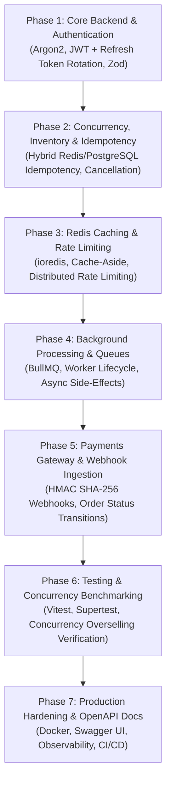

# Project Roadmap & Master Plan

**Project:** Order & Inventory Management API  
**Architecture:** Modular Monolith (TypeScript, Express.js, Prisma, PostgreSQL, Redis, BullMQ)  
**Status:** All Phase Discussions Concluded & Context Locked  
**Updated:** 2026-11-23  

---

## Roadmap Overview

---

## Phase Breakdown

### Phase 1: Core Backend & Authentication
- **Status:** Discussion Concluded ([`01-CONTEXT.md`](file:///home/aravind/Nodejs_Projects_Adv/order-inventory-api/.planning/01-CONTEXT.md))
- **Key Deliverables:**
  - Password hashing with **Argon2**
  - **Stateless JWT Access Token** (Bearer) + **Persistent Refresh Token Rotation**
  - Schema additions: `RefreshToken` table in PostgreSQL
  - Input validation middleware powered by **Zod**
  - Role-based access control (`CUSTOMER`, `ADMIN` via `ADMIN_REGISTRATION_SECRET`)
  - Integration with Order creation: Remove `TEMPORARY_TEST_USER_ID`, bind orders to `req.user.id`
  - Admin catalog creation (`POST /api/v1/products`)

---

### Phase 2: Concurrency, Inventory & Idempotency
- **Status:** Discussion Concluded ([`02-CONTEXT.md`](file:///home/aravind/Nodejs_Projects_Adv/order-inventory-api/.planning/02-CONTEXT.md))
- **Key Deliverables:**
  - **Hybrid Idempotency Framework:** In-flight distributed lock in Redis + persistent `IdempotencyRecord` table in PostgreSQL
  - Transactional checkout guarantees: Serializable isolation, deterministic locking order, deadlock retry logic
  - Order cancellation (`POST /api/v1/orders/:id/cancel`): Atomic stock replenishment and state machine guards
  - Order listing and detail endpoints (`GET /api/v1/orders`, `GET /api/v1/orders/:id`) with strict customer isolation and pagination

---

### Phase 3: Redis Caching & Rate Limiting
- **Status:** Discussion Concluded
- **Key Deliverables:**
  - Robust Redis client setup using `ioredis` with auto-reconnect and graceful error fallback
  - **Cache-Aside Pattern** for product catalog (`GET /api/v1/products` and `GET /api/v1/products/:id`)
  - Automated cache invalidation on product creation, price updates, or stock adjustments
  - Distributed Rate Limiting middleware with token bucket / sliding window (standard tier: 100 req/min, sensitive auth/checkout tier: 10 req/min)

---

### Phase 4: Background Processing & Queues (BullMQ)
- **Status:** Discussion Concluded
- **Key Deliverables:**
  - BullMQ queue manager and worker process infrastructure
  - Domain event bridge: `orderEventBus` dispatches events into BullMQ job queues
  - Asynchronous background jobs: order confirmation notifications, low-stock alerts, and pending payment timeout reconciliation
  - Retry strategies with exponential backoff and Dead Letter Queue (DLQ) logging

---

### Phase 5: Payments Gateway & Webhook Ingestion
- **Status:** Discussion Concluded
- **Key Deliverables:**
  - Mock external payment gateway client integrating timeout primitives (`withTimeout`)
  - Payment initiation endpoint (`POST /api/v1/orders/:id/pay`)
  - Secure Webhook ingestion endpoint (`POST /api/v1/payments/webhook`)
  - **HMAC SHA-256 signature verification** for webhook payloads
  - Webhook idempotency and transactional order state transitions (`PENDING` -> `PAID` or `FAILED`)

---

### Phase 6: Testing & Concurrency Benchmarking
- **Status:** Discussion Concluded
- **Key Deliverables:**
  - Testing suite built with **Vitest** and **Supertest**
  - Unit tests: Services, domain business logic, error classes, retry policies
  - Integration tests: End-to-end user journeys (Register -> Login -> Browse Products -> Checkout with Idempotency -> Payment Webhook -> Verify Order Status)
  - **Concurrency Stress Test:** Simulating high-concurrency simultaneous checkouts on limited inventory to rigorously prove **zero overselling** and proper deadlock recovery

---

### Phase 7: Production Hardening, Observability & OpenAPI Docs
- **Status:** Discussion Concluded
- **Key Deliverables:**
  - Containerization: Multi-stage `Dockerfile` and `docker-compose.yml` (App, PostgreSQL, Redis)
  - Interactive API documentation with **Swagger / OpenAPI 3.0** via `swagger-ui-express` (`/api-docs`)
  - Comprehensive health check endpoint (`GET /health`) checking PostgreSQL pool and Redis ping
  - Unified graceful shutdown orchestrator (Express, Prisma connection pool, Redis, BullMQ workers)
  - GitHub Actions CI workflow (linting, typechecking, and automated test execution)
