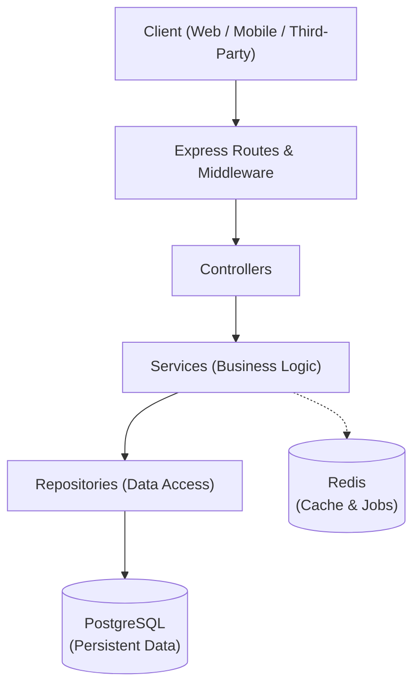

# Architecture Document

## 1. Overview

The Order & Inventory API is structured as a **Modular Monolith**. This pattern provides clear separation of concerns, strong domain boundaries, and simple deployment while allowing individual modules to evolve independently without distributed-system overhead.

---

## 2. Request Flow Architecture

---

## 3. Layer Responsibilities

| Layer | Responsibility | Details & Key Capabilities |
| :--- | :--- | :--- |
| **Routes** | Map HTTP requests to handlers | Defines URL endpoints, HTTP methods (`GET`, `POST`, `PUT`, `DELETE`), and matches incoming requests with their respective middleware and controllers. |
| **Middleware** | Cross-cutting request processing | Handles request authentication/authorization, input schema validation, request logging, rate limiting, and idempotency header verification. |
| **Controllers** | HTTP request and response management | Extracts request parameters/body, calls the appropriate service method, and formats the HTTP response status code and JSON payload. Contains no business logic. |
| **Services** | Core business logic execution | Enforces all domain rules (e.g., inventory checks, price calculations, state transitions) and coordinates transactions and background tasks across repositories and external services. |
| **Repositories** | Database communication & queries | Abstracts database interactions, executing SQL queries, joins, locking mechanisms, and atomic database transaction rollbacks/commits. |

---

## 4. Data & Caching Stores

### PostgreSQL (Persistent Data)
- Primary relational data store for all persistent domain entities (Users, Products, Inventory, Orders, OrderItems, Payments).
- Guarantees ACID transactions, essential for preventing negative inventory and partial updates during multi-step order placement.

### Redis (Cache & Jobs)
- In-memory data store used for fast caching of product catalogs and frequently read data.
- Powers distributed locks (concurrency control), background job queues (e.g., asynchronous payment handling/notifications), and idempotency key caching.

