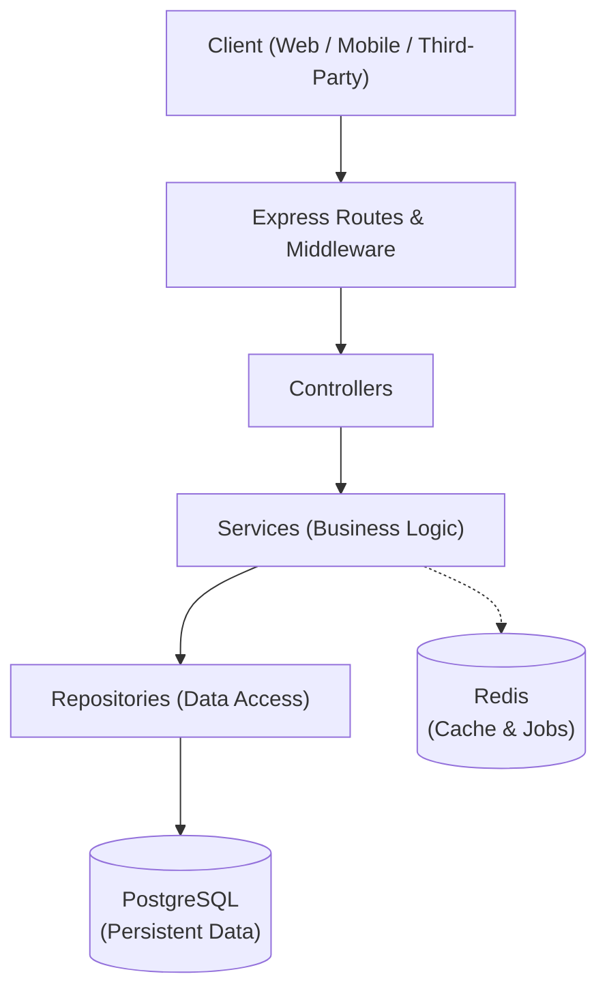

# Architecture Document

## 1. Overview

The Order & Inventory API is structured as a **Modular Monolith**. This pattern provides clear separation of concerns, strong domain boundaries, and simple deployment while allowing individual modules to evolve independently without distributed-system overhead.

---

## 2. Request Flow Architecture



---

## 3. Layer Responsibilities

| Layer | Responsibility | Details & Key Capabilities |
| :--- | :--- | :--- |
| **Routes** | Map HTTP requests to handlers | Defines URL endpoints, HTTP methods (`GET`, `POST`, `PUT`, `DELETE`), and matches incoming requests with their respective middleware and controllers. |
| **Middleware** | Cross-cutting request processing | Handles request authentication/authorization, input schema validation, request logging, rate limiting, and idempotency header verification. |
| **Controllers** | HTTP request and response management | Extracts request parameters/body, calls the appropriate service method, and formats the HTTP response status code and JSON payload. Contains no business logic. |
| **Services** | Core business logic execution | Enforces all domain rules (e.g., inventory checks, price calculations, state transitions) and coordinates transactions and background tasks across repositories and external services. |
| **Repositories** | Database communication & queries | Abstracts database interactions, executing SQL queries, joins, locking mechanisms, and atomic database transaction rollbacks/commits. |

---

## 4. Data & Caching Stores

### PostgreSQL (Persistent Data)
- Primary relational data store for all persistent domain entities (Users, Products, Inventory, Orders, OrderItems, Payments).
- Guarantees ACID transactions, essential for preventing negative inventory and partial updates during multi-step order placement.

### Redis (Cache & Jobs)
- In-memory data store used for fast caching of product catalogs and frequently read data.
- Powers distributed locks (concurrency control), background job queues (e.g., asynchronous payment handling/notifications), and idempotency key caching.

---

## 5. Resilience & Timeout Management (`withTimeout` Utility)

To ensure service reliability, prevent cascading failures, and maintain bounded request lifecycles, asynchronous external and internal I/O operations must be protected with timeouts. The project provides a reusable utility in `src/utils/withTimeout.js`.

### 1. Why External Operations Need Timeouts
In production systems, calls to external dependencies (third-party payment gateways, postal/shipping APIs, notification webhooks) or even internal data stores (PostgreSQL connection pools, Redis) can experience network partitions, latency spikes, socket hangs, or deadlocks:
- **Preventing Resource Starvation:** Without timeouts, open sockets, pending database connections, and memory allocations remain occupied indefinitely. Under load, this exhausts connection pools and worker threads.
- **Bounding Client Latency:** Upstream clients (web apps, mobile clients) cannot wait indefinitely. Enforcing strict timeouts allows the system to fail fast and trigger appropriate fallbacks or informative error responses.
- **Preventing Cascading Failures:** When an external dependency hangs, queued requests accumulate quickly, saturating the Node.js event loop and dragging down unrelated features across the entire backend cluster.

### 2. Why a Promise Timeout Doesn't Automatically Cancel the Operation
A common misconception in JavaScript is that racing an operation against a timer cancels the losing promise:
```javascript
// ANTIPATTERN: Does NOT cancel operation()!
await Promise.race([operation(), timeoutPromise]);
```
- In JavaScript, Promises are **non-cancellable** state machines. Once an asynchronous operation is initiated, settling the outer `Promise.race()` merely stops *awaiting* the promise; it does not stop, abort, or roll back the underlying asynchronous execution.
- If the operation continues running in the background, it becomes a **zombie operation**. It continues to consume CPU, memory, and database connections, and may execute unintended side effects (such as processing an unwanted payment or writing orphaned records) long after the caller has given up.

### 3. Why Cancellation Signals Matter
To achieve true cancellation, the operation and the timeout mechanism must cooperate using standard primitives—specifically `AbortController` and `AbortSignal`:
- `withTimeout` instantiates an `AbortController` and injects its `AbortSignal` directly into the operation: `operation(signal)`.
- When the timeout fires, `controller.abort(timeoutError)` signals the operation to cancel.
- Cooperative operations (such as Node `fetch()`, database drivers with abort support, or custom business loops) listen for the `'abort'` event or call `signal.throwIfAborted()`.
- Upon abort notification, the underlying operation immediately terminates socket connections, rolls back in-flight transactions, and releases connection pool slots.

### 4. Application Integration Points
The `withTimeout` utility is designed for critical layers across the modular monolith:
- **Payment Processing (`PaymentService`):**
  Guards third-party payment gateway calls. If the provider hangs beyond the configured threshold, the request is aborted cooperatively before committing an ambiguous order state.
- **Inventory Locking & Concurrency Control (`InventoryService` / `Repositories`):**
  Guards multi-item row-locking transactions (`SELECT ... FOR UPDATE`) during checkout to ensure locks cannot be held indefinitely if a client disconnects or an error stalls the transaction.
- **Distributed Cache & Redis Locks (`Services`):**
  Wraps distributed lock acquisition, renewal, and idempotency checks in Redis to avoid deadlocks in high-concurrency checkout pipelines.
- **External Webhooks & Notifications (`NotificationService` / Background Workers):**
  Ensures background worker jobs that push notifications or receipts don't stall queues when external servers experience downtime.


