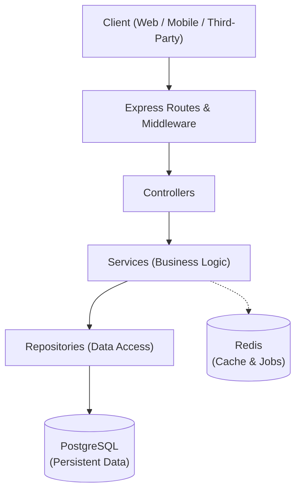

# Architecture Document

## 1. Overview

The Order & Inventory API is structured as a **Modular Monolith**. This pattern provides clear separation of concerns, strong domain boundaries, and simple deployment while allowing individual modules to evolve independently without distributed-system overhead.

---

## 2. Request Flow Architecture



---

## 3. Layer Responsibilities

| Layer | Responsibility | Details & Key Capabilities |
| :--- | :--- | :--- |
| **Routes** | Map HTTP requests to handlers | Defines URL endpoints, HTTP methods (`GET`, `POST`, `PUT`, `DELETE`), and matches incoming requests with their respective middleware and controllers. |
| **Middleware** | Cross-cutting request processing | Handles request authentication/authorization, input schema validation, request logging, rate limiting, and idempotency header verification. |
| **Controllers** | HTTP request and response management | Extracts request parameters/body, calls the appropriate service method, and formats the HTTP response status code and JSON payload. Contains no business logic. |
| **Services** | Core business logic execution | Enforces all domain rules (e.g., inventory checks, price calculations, state transitions) and coordinates transactions and background tasks across repositories and external services. |
| **Repositories** | Database communication & queries | Abstracts database interactions, executing SQL queries, joins, locking mechanisms, and atomic database transaction rollbacks/commits. |

---

## 4. Data & Caching Stores

### PostgreSQL (Persistent Data)
- Primary relational data store for all persistent domain entities (Users, Products, Inventory, Orders, OrderItems, Payments).
- Guarantees ACID transactions, essential for preventing negative inventory and partial updates during multi-step order placement.

### Redis (Cache & Jobs)
- In-memory data store used for fast caching of product catalogs and frequently read data.
- Powers distributed locks (concurrency control), background job queues (e.g., asynchronous payment handling/notifications), and idempotency key caching.

---

## 5. Resilience & Timeout Management (`withTimeout` Utility)

To ensure service reliability, prevent cascading failures, and maintain bounded request lifecycles, asynchronous external and internal I/O operations must be protected with timeouts. The project provides a reusable utility in `src/utils/withTimeout.js`.

### 1. Why External Operations Need Timeouts
In production systems, calls to external dependencies (third-party payment gateways, postal/shipping APIs, notification webhooks) or even internal data stores (PostgreSQL connection pools, Redis) can experience network partitions, latency spikes, socket hangs, or deadlocks:
- **Preventing Resource Starvation:** Without timeouts, open sockets, pending database connections, and memory allocations remain occupied indefinitely. Under load, this exhausts connection pools and worker threads.
- **Bounding Client Latency:** Upstream clients (web apps, mobile clients) cannot wait indefinitely. Enforcing strict timeouts allows the system to fail fast and trigger appropriate fallbacks or informative error responses.
- **Preventing Cascading Failures:** When an external dependency hangs, queued requests accumulate quickly, saturating the Node.js event loop and dragging down unrelated features across the entire backend cluster.

### 2. Why a Promise Timeout Doesn't Automatically Cancel the Operation
A common misconception in JavaScript is that racing an operation against a timer cancels the losing promise:
```javascript
// ANTIPATTERN: Does NOT cancel operation()!
await Promise.race([operation(), timeoutPromise]);
```
- In JavaScript, Promises are **non-cancellable** state machines. Once an asynchronous operation is initiated, settling the outer `Promise.race()` merely stops *awaiting* the promise; it does not stop, abort, or roll back the underlying asynchronous execution.
- If the operation continues running in the background, it becomes a **zombie operation**. It continues to consume CPU, memory, and database connections, and may execute unintended side effects (such as processing an unwanted payment or writing orphaned records) long after the caller has given up.

### 3. Why Cancellation Signals Matter
To achieve true cancellation, the operation and the timeout mechanism must cooperate using standard primitives—specifically `AbortController` and `AbortSignal`:
- `withTimeout` instantiates an `AbortController` and injects its `AbortSignal` directly into the operation: `operation(signal)`.
- When the timeout fires, `controller.abort(timeoutError)` signals the operation to cancel.
- Cooperative operations (such as Node `fetch()`, database drivers with abort support, or custom business loops) listen for the `'abort'` event or call `signal.throwIfAborted()`.
- Upon abort notification, the underlying operation immediately terminates socket connections, rolls back in-flight transactions, and releases connection pool slots.

### 4. Application Integration Points
The `withTimeout` utility is designed for critical layers across the modular monolith:
- **Payment Processing (`PaymentService`):**
  Guards third-party payment gateway calls. If the provider hangs beyond the configured threshold, the request is aborted cooperatively before committing an ambiguous order state.
- **Inventory Locking & Concurrency Control (`InventoryService` / `Repositories`):**
  Guards multi-item row-locking transactions (`SELECT ... FOR UPDATE`) during checkout to ensure locks cannot be held indefinitely if a client disconnects or an error stalls the transaction.
- **Distributed Cache & Redis Locks (`Services`):**
  Wraps distributed lock acquisition, renewal, and idempotency checks in Redis to avoid deadlocks in high-concurrency checkout pipelines.
- **External Webhooks & Notifications (`NotificationService` / Background Workers):**
  Ensures background worker jobs that push notifications or receipts don't stall queues when external servers experience downtime.

---

## 6. Technology Choices & Type Strategy

### 1. Why We Chose TypeScript
- **Compile-Time Type Safety:** E-commerce and inventory workflows involve multi-step state transitions, monetary calculations, and inventory reservations. TypeScript detects mismatches and illegal state access during development rather than during live user checkouts.
- **Explicit Domain Contracts:** Interfaces and types serve as living, compiler-verified documentation across the layered architecture (`Routes` → `Controllers` → `Services` → `Repositories`).
- **Refactoring Confidence:** Large codebases evolve rapidly. TypeScript allows renaming domain properties, restructuring service signatures, or updating database entities with instant feedback on every affected file across the project.
- **Enhanced Developer Experience:** Autocompletion, inline documentation, and intelligent code navigation dramatically reduce cognitive overhead and eliminate entire classes of common bugs (e.g., misspelled properties or undefined method calls).

### 2. Why We Chose ESM (ECMAScript Modules)
- **Official Modern JavaScript Standard:** ESM (`import` / `export`) is the native specification for JavaScript in both modern Node.js runtimes and browser environments, replacing legacy CommonJS (`require` / `module.exports`).
- **Static Analysis & Tree-Shaking:** ESM syntax is statically analyzable at build time, enabling tooling to eliminate unused code (tree-shaking) and perform faster bundling.
- **Ecosystem Alignment:** The broader Node.js ecosystem has shifted decisively toward ESM-first and ESM-only packages. Choosing ESM avoids friction with modern libraries and dual-package compatibility hazards.
- **Standardized Features:** ESM natively supports top-level `await`, unambiguous module boundaries, and standardized path resolution.

### 3. Why Domain Types Are Separated from Controllers and Services
- **Single Source of Truth:** Core business entities (e.g., `Order`, `Product`, `InventoryItem`, `Money`) define the fundamental rules of the business and must exist independently of HTTP frameworks or database drivers.
- **Protocol Independence:** Separating domain types ensures that business logic is completely decoupled from transport protocols. The same domain models can be used across HTTP REST controllers, background queue workers, CLI scripts, or potential future protocols (e.g., gRPC, GraphQL) without modification.
- **Encapsulation & Boundary Isolation:** Controllers deal with HTTP concerns (status codes, headers, raw JSON bodies, query parameters), while Repositories deal with database records. Keeping domain types in a dedicated layer prevents internal database details (e.g., password hashes, internal foreign keys) from leaking into API contracts, and prevents HTTP metadata from polluting business logic.
- **Reusability & Circular Dependency Prevention:** Centralizing domain contracts in their own layer prevents circular dependencies between controllers, services, and repositories.

### 4. What TypeScript Catches at Compile Time
TypeScript acts as an automated static verification layer, catching the following errors prior to execution:
- **Type Mismatches:** Passing an incompatible type (e.g., providing a `string` where a numeric `price` or a `Date` is required).
- **Missing or Extra Properties:** Constructing objects with missing required fields or misspelled keys.
- **Property Typos & Undefined Access:** Calling non-existent methods or reading properties that do not exist on the type.
- **Null and Undefined Dereferencing:** With `strictNullChecks` enabled, TypeScript flags potential crashes from attempting to access properties on `null` or `undefined` values.
- **Exhaustiveness & Unhandled State Invariants:** Flags unhandled branches in `switch` or `if` statements when handling domain enums (e.g., failing to handle `CANCELLED` in order status state machines).
- **Function Signature Mismatches:** Calling functions with incorrect argument counts, invalid argument types, or handling return types incorrectly.

### 5. Why Runtime Validation Remains Essential
While TypeScript provides comprehensive compile-time guarantees, it does not replace runtime validation:
- **Type Erasure:** TypeScript types exist solely during compilation and are completely removed when transpiled to JavaScript. At runtime, pure JavaScript executes with zero innate knowledge of TypeScript types.
- **Untrusted External Boundaries:** API endpoints receive arbitrary, unverified JSON payloads over the network from external clients. TypeScript cannot prevent a client from submitting malformed payloads, out-of-range values (e.g., negative quantity, non-UUID product IDs), or malicious injection attacks.
- **Contract Enforcement at the Edge:** Runtime validation (using schema validators such as Zod or Joi) inspects incoming payloads at the boundary (middleware/controller level). It validates constraints that the type system alone cannot verify (e.g., string length, email format, positive integers, regex patterns), rejects invalid input with descriptive 400 Bad Request responses, and safely casts parsed data into validated TypeScript domain types before it reaches the core services.

---

## 7. Event Bus Architecture & Production Limitations (`EventEmitter`)

The application introduces an event-driven mechanism (`OrderEventBus`) built atop Node.js's native `EventEmitter` to decouple domain side-effects (e.g., local logging, analytics, audit tracking) from core transactional order workflows. While `EventEmitter` is lightweight, zero-dependency, and strictly typed with TypeScript, it has critical architectural constraints in production environments:

### 1. In-Memory Operation
- Node.js's `EventEmitter` operates strictly within the memory heap of a single Node.js process.
- Events published on one server instance or container replica are completely invisible to other instances in a horizontal multi-replica or clustered deployment. It cannot distribute load across independent consumer instances.

### 2. Synchronous Execution Model
- When `emitter.emit(event, payload)` is called, `EventEmitter` invokes registered listeners **synchronously and in registration order**.
- If any listener performs heavy CPU computation or blocks the event loop, the entire calling workflow (including the HTTP request thread) is blocked until that listener returns.
- Even when listeners return Promises (async functions), `emit()` does not await those promises—it returns `true` or `false` immediately after scheduling their initial tick.

### 3. Ephemeral State & Process Restarts
- In-memory events have no persistence or disk backing.
- If the Node.js process crashes, encounters an unhandled exception, or restarts during a deployment or auto-scaling event, all pending in-flight events or asynchronous operations scheduled by event listeners are permanently lost.

### 4. Asynchronous Listener Failures & Error Handling
- By default, `EventEmitter` does not await asynchronous listeners (`async (payload) => { ... }`).
- If an asynchronous listener rejects or throws an unhandled error inside a promise:
  - The error does not propagate back to the caller of `emit()`.
  - In modern Node.js, an unhandled rejection in a detached promise triggers an `unhandledRejection` event and may terminate the Node.js process if unhandled.
  - Asynchronous event listeners must implement explicit `try/catch` blocks, logging, and error boundaries internally.

### 5. Lack of Durable Delivery, Acknowledgments, and Retries
- `EventEmitter` is a "fire-and-forget" pub/sub primitive.
- It does not support consumer acknowledgments (ACK/NACK), dead-letter queues (DLQ), delivery guarantees (at-least-once or exactly-once), backoff retries, or rate limiting.
- If a downstream dependency (e.g., email service provider or webhook destination) is temporarily down, the event fails silently and is never retried.

### 6. When to Use a Message Queue (Production Readiness)
For mission-critical background jobs, distributed events, and resilient decoupled architecture, a dedicated distributed message broker / queue (such as Redis BullMQ, RabbitMQ, Kafka, or AWS SQS) is required:
- **Durability:** Events are persisted to disk or external memory stores until explicit worker acknowledgment.
- **Retry Mechanisms:** Exponential backoff, jitter, and dead-letter queues handle transient third-party outages gracefully.
- **Horizontal Scalability:** Multiple worker processes or containers consume from the same queue, balancing load and preventing service degradation.
- **Observability:** Provides queue length monitoring, failed job inspection, retry mechanisms, and distributed tracing.

*Recommendation for Order & Inventory API:* Use `OrderEventBus` for local, non-critical, in-process notifications (such as audit logging, metrics dispatch, and local caching triggers), while delegating transactional side-effects (payment settlements, inventory reconciliation, customer email receipts, warehouse fulfillment dispatch) to a distributed queue like BullMQ powered by Redis.

---

## 8. Application Lifecycle, Configuration & Error Architecture

As the application scales into a production-grade service, foundational infrastructure concerns—configuration management, domain error taxonomies, and process lifecycle mechanics—must be standardized.

### 1. Why Configuration Should Be Centralized
- **Single Source of Truth:** Direct access to `process.env` throughout controllers, services, and repositories scatters configuration logic across the codebase. Centralizing in `src/config/env.ts` guarantees one predictable origin for all runtime options.
- **Consistency & Predictable Defaults:** Centralization prevents divergent fallbacks across files (e.g., one module assuming `PORT=3000` while another assumes `PORT=8080`).
- **Strong Typing & Developer Ergonomics:** The application consumes a typed `AppConfig` object rather than ambiguous `string | undefined` variables, providing IDE autocompletion and compile-time verification.
- **Test Isolation:** Exposing `loadConfig(env)` allows unit and integration test suites to supply custom configuration dictionaries without polluting or mutating the global `process.env`.

### 2. Why Environment Variables Should Be Validated During Startup
- **Fail-Fast Principle:** Boot-time validation stops the application immediately if an environment variable is invalid (e.g., non-numeric `PORT`, missing database credentials, invalid `NODE_ENV`), preventing cryptic runtime failures hours or days after deployment.
- **Preventing Type Coercion & Out-of-Range Bugs:** In Node.js, `process.env` values are always strings. Without parsing and range checking, strings like `"0"`, `"65536"`, or `""` cause subtle connection or port-binding defects.
- **Safer Deployments:** Container orchestrators (Kubernetes, Docker Swarm, AWS ECS) rely on container exit codes during rolling updates. Failing at boot causes the rollout to halt, keeping previous healthy replicas running and preventing bad deployments from taking down user-facing traffic.

### 3. Why Application Errors Are Separate from Native JavaScript Errors
- **Operational vs. Programmer Errors:**
  - *Programmer errors* (`TypeError`, `ReferenceError`, `SyntaxError`) are unexpected software bugs that require code fixes.
  - *Operational errors* (`ConfigurationError`, `ValidationError`, `NotFoundError`, `ConflictError`) represent anticipated domain conditions (e.g., bad user input, missing records, invalid configuration).
- **Machine-Readable Codes:** The `AppError` base class attaches standardized error codes (e.g., `code: "CONFIGURATION_ERROR"`, `code: "INSUFFICIENT_STOCK"`). These codes drive consistent HTTP status mapping and client-facing API error contracts.
- **Security & Information Leaks:** Returning raw native errors or stack traces exposes database table names, SQL queries, and internal paths to attackers. Custom error boundaries let middleware safely expose meaningful domain messages while masking internal faults as generic `500 Internal Server Error`.
- **Error Causality Chaining:** Leveraging ES2022 `options.cause` enables application errors to wrap lower-level infrastructure failures (e.g., database driver timeouts) with domain context while preserving the underlying stack trace for telemetry.

### 4. Why Graceful Shutdown Is Important in Backend Applications
- **Data Integrity & Transaction Safety:** Abruptly stopping an e-commerce service risks severing in-flight multi-step operations (e.g., customer payment charged while inventory deduction was mid-transaction), producing orphaned records and inventory drift.
- **Zero-Downtime Rolling Deployments:** When orchestrators deploy new versions, they send `SIGTERM` to existing containers. Graceful shutdown gives active HTTP requests the necessary window to complete before the container terminates.
- **Clean Socket & Connection Teardown:** Orderly disconnections notify downstream databases and caches to reclaim connection pool slots immediately rather than waiting for TCP keep-alive timeouts.

### 5. Why We Avoid Forcibly Exiting the Application (`process.exit()`)
- **Abrupt Event Loop Truncation:** Calling `process.exit()` immediately terminates the V8 process, severing active TCP sockets, dropping in-flight HTTP responses, and truncating unflushed logging streams (e.g., Pino or Winston buffers).
- **Interrupted Asynchronous Teardown:** Asynchronous cleanup routines (draining database connections, flushing message queues) cannot finish if the process is terminated synchronously.
- **Natural Event Loop Drainage:** Node.js automatically exits when its event loop has no remaining active handles, open sockets, or pending timers. The lifecycle manager allows this natural drain, setting `process.exitCode = 1` only when cleanup fails to signal failure to the process supervisor.

### 6. Resources to Be Closed During Graceful Shutdown
During the shutdown sequence triggered by `SIGINT` or `SIGTERM`, the application must close resources in a controlled order:
1. **HTTP Server (`server.close()`):** Stop accepting new incoming client requests while allowing active in-flight requests to complete within a bounded grace period.
2. **Background Queue Consumers & Workers (e.g., BullMQ / Redis Workers):** Pause queues to prevent pulling new jobs and wait for currently executing jobs to finish.
3. **Database Connection Pools (`pool.end()` / PostgreSQL):** Complete in-flight SQL queries, roll back uncommitted transactions, and close idle database connections.
4. **Cache & In-Memory Stores (`redis.quit()`):** Flush remaining writes, release distributed locks, and cleanly close Redis connections.
5. **Periodic Timers & Schedulers:** Clear recurring background timers (`setInterval`) or cron jobs to ensure the Node.js event loop empties completely.


